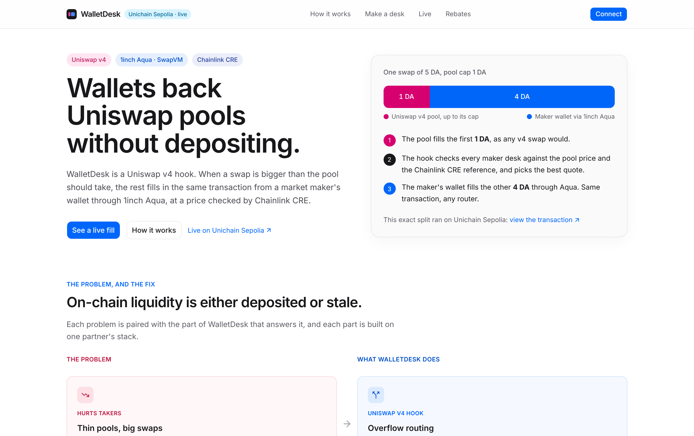
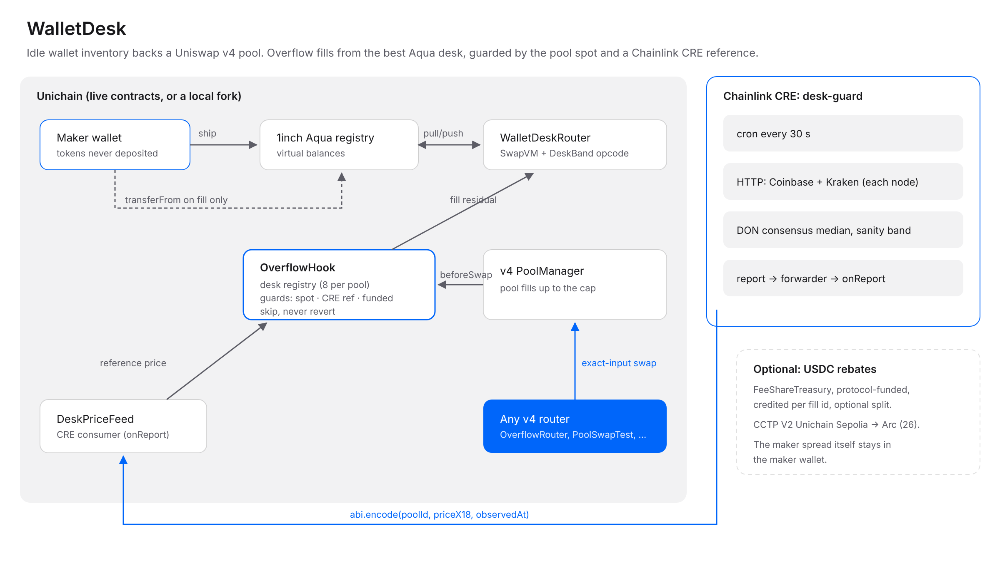
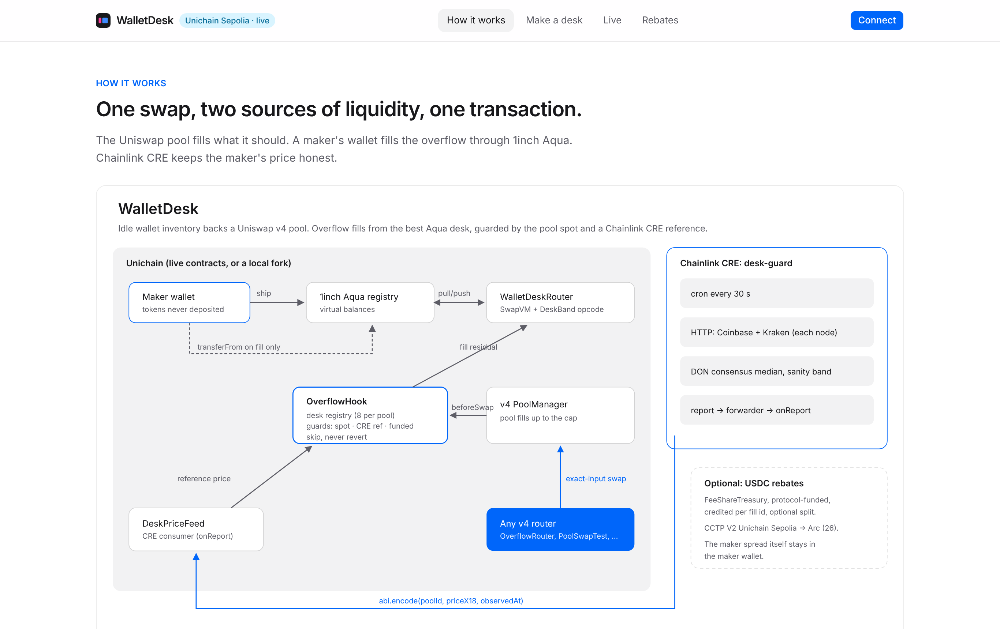
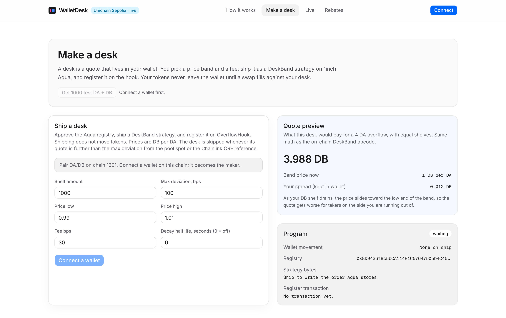
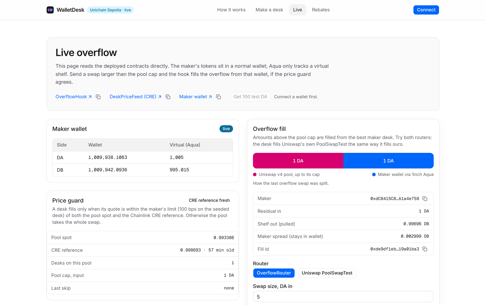

# WalletDesk

**Wallet-native liquidity for Uniswap v4.** Market makers back a v4 pool straight from their wallets, without
depositing. Large swaps fill the pool up to a cap, and the rest comes from the best maker in the same transaction, at
a price checked against Chainlink CRE.

Uniswap v4 hook · 1inch Aqua + custom SwapVM opcode · Chainlink CRE price guard ·
**[Live on Unichain Sepolia](docs/DEPLOYMENTS.md)** · [Judge in 5 minutes](docs/JUDGING.md)

> **Demo video:** _TODO (team): paste the video link here before submitting._



ETHGlobal Mumbai 2026. Partner tracks: **1inch** (Build an Aqua App), **Uniswap Foundation** (Build with Uniswap),
**Chainlink** (Best workflow with CRE).

## The problem

1. **Pools are only as deep as deposited capital.** A large swap on a thin Uniswap v4 pool walks the curve and pays
   heavy price impact.
2. **The capital that could help sits idle.** Makers and treasuries hold inventory in wallets. To provide liquidity
   today they must deposit it into a pool: custody risk, lockup, and liquidity split across venues.
3. **Static on-chain quotes get picked off.** A price band that was fair an hour ago is free money for arbitrageurs
   once the market moves.

## The solution

| Problem | WalletDesk |
| --- | --- |
| Idle wallet capital | **1inch Aqua.** A maker ships a DeskBand strategy (our own SwapVM instruction). Aqua records virtual balances; the tokens stay in the wallet and are pulled only when a fill happens. |
| Thin pools | **Uniswap v4 hook.** For an exact-input swap above the pool cap, the pool fills the cap and `OverflowHook` fills the rest from the best maker desk in the same transaction. Works with any v4 router. |
| Stale quotes | **Chainlink CRE.** A CRE workflow writes an off-chain reference price (Coinbase + Kraken, DON consensus) to `DeskPriceFeed`. A desk fills only within the maker's limit of both the pool spot and that reference. A desk never reverts a swap; when it is skipped, the pool fills everything. |

## See it work

| Proof | Where |
| --- | --- |
| **Live overflow fills on Unichain Sepolia.** Pool fills 1, the maker wallet fills the rest through Aqua `Pulled` / `Pushed` | [swap via OverflowRouter](https://sepolia.uniscan.xyz/tx/0x0c169e96abd27278b2330755717034dc30bc5d7eed5be48dbc48dbc43bff0340), [swap via Uniswap's stock PoolSwapTest](https://sepolia.uniscan.xyz/tx/0x8d2b81fe61e8d7f5ea1187e32b6d8ad81904df3b3de595556a7809286f305d6e), all 31 transactions in [DEPLOYMENTS.md](docs/DEPLOYMENTS.md) |
| **CRE simulation passed** against the live Sepolia feed: Coinbase 0.998950, Kraken 0.998951 → consensus 0.998950; read on-chain reference `998615000000000000`; `action: written` | [SIMULATION.md](services/cre/desk-guard/SIMULATION.md) |
| **Tests:** 38 local Foundry tests; the hook suite again (21 tests) on a Unichain mainnet fork against the live PoolManager and Aqua; 19 CRE workflow tests, including a regression for the WASM engine's missing `URL`; 7 keeper tests | [contracts/test](contracts/test), [services/cre/desk-guard](services/cre/desk-guard), [services/keeper](services/keeper) |
| **CI green:** forge (local, fork, sizes), keeper, CRE, web lint + build | [.github/workflows/ci.yml](.github/workflows/ci.yml) |

## How it works



1. **Ship.** The maker approves Aqua and ships a DeskBand order. Nothing moves; Aqua records virtual balances.
2. **Register.** `OverflowHook.registerDesk` checks the order is really shipped, rejects maker-hook traits, and stores
   the maker's `maxDeviationBps`. Up to 8 desks per pool, one per maker.
3. **Swap.** Any v4 router swaps more than the pool cap. The hook quotes every desk and drops any desk that is outside
   its limit of the pool spot or the CRE reference, or whose wallet cannot pay. The best quote wins.
4. **Fill.** The hook advances the residual from PoolManager reserves, pays the maker through SwapVM (Aqua `pull` /
   `push`), settles the maker's output, and returns a `BeforeSwapDelta` that charges the caller.
5. **Never block.** If the SwapVM call reverts, the hook hands the residual back and the pool fills the whole swap.
   Every skip emits `DeskSkipped(reason)`.

Details: [architecture.md](docs/architecture.md), design spec [spec/DESIGN.md](docs/spec/DESIGN.md).

## Partner integrations

### Uniswap v4

| What | Code |
| --- | --- |
| Hook permissions: `beforeSwap` + `beforeSwapReturnDelta` | [OverflowHook.sol#L270](contracts/src/OverflowHook.sol#L270) |
| Cap, residual, PoolManager reserve check, `WouldRoute` | [#L301](contracts/src/OverflowHook.sol#L301), reserves [#L322](contracts/src/OverflowHook.sol#L322) |
| Best desk and guards (spot, CRE reference, funded wallet) | [#L344](contracts/src/OverflowHook.sol#L344), [#L364](contracts/src/OverflowHook.sol#L364) |
| Advance the residual from reserves (`take`) | [#L388](contracts/src/OverflowHook.sol#L388) |
| Failed fill: refund with `sync` / `settle`, zero delta | [#L393](contracts/src/OverflowHook.sol#L393) |
| `BeforeSwapDelta` that charges the swap caller | [#L428](contracts/src/OverflowHook.sol#L428) |
| Pool spot from `slot0` in the v4 price unit | [#L263](contracts/src/OverflowHook.sol#L263) |
| Optional taker router with slippage check | [OverflowRouter.sol#L43](contracts/src/OverflowRouter.sol#L43) |
| Uniswap's stock `PoolSwapTest` router fills from a desk | [`test_stockV4RouterFillsFromDesk`](contracts/test/Overflow.t.sol#L337), [live tx](https://sepolia.uniscan.xyz/tx/0x8d2b81fe61e8d7f5ea1187e32b6d8ad81904df3b3de595556a7809286f305d6e) |
| Same suite against the live Unichain PoolManager `0x1F98…0004` | [`OverflowForkTest`](contracts/test/Overflow.t.sol#L697) |

Uniswap feedback: [FEEDBACK.md](FEEDBACK.md).

### 1inch Aqua / SwapVM

| What | Code |
| --- | --- |
| DeskBand instruction (new SwapVM opcode) | [DeskBand.sol#L21](contracts/src/swapvm/DeskBand.sol#L21) |
| Pricing: v4 price unit, both directions, value-weighted band, decay, fee | [DeskBandMath.sol#L45](contracts/src/swapvm/DeskBandMath.sol#L45), [#L81](contracts/src/swapvm/DeskBandMath.sol#L81) |
| Opcode table on the redeployed SwapVM | [WalletDeskRouter.sol#L58](contracts/src/swapvm/WalletDeskRouter.sol#L58) |
| `preview` runs the same math as the opcode | [WalletDeskRouter.sol#L33](contracts/src/swapvm/WalletDeskRouter.sol#L33) |
| Order packing with the SwapVM trait encoders | [OrderBuilder.sol#L28](contracts/src/swapvm/OrderBuilder.sol#L28) |
| Unmodified `Aqua.push` / `Aqua.pull` in SwapVM v1.0.2 | [SwapVM.sol#L237](contracts/lib/swap-vm/src/SwapVM.sol#L237), [#L286](contracts/lib/swap-vm/src/SwapVM.sol#L286) |
| Shipped-strategy check; deliverable inventory (min of shipped, wallet, allowance) | [OverflowHook.sol#L181](contracts/src/OverflowHook.sol#L181), [#L515](contracts/src/OverflowHook.sol#L515) |
| Ship leaves the wallet untouched; quote equals swap; both directions priced correctly | [`test_shipDoesNotMoveWallet_quoteMatchesSwap`](contracts/test/DeskBand.t.sol#L140), [`test_bothDirectionsWithMixedDecimals`](contracts/test/DeskBand.t.sol#L74) |

On Unichain mainnet the desk uses the live Aqua registry `0x1111113CCf1426A8E30e2bfF5E005d929bF6a90a`. Aqua has no
code on Unichain Sepolia, so the Sepolia deployment uses an unmodified Aqua deployed by our script. The canonical
`AquaSwapVMRouter` has no DeskBand opcode, so we redeploy a modified SwapVM, which 1inch's rules allow:
[SWAPVM_DIFF.md](docs/SWAPVM_DIFF.md).

### Chainlink CRE

| What | Code |
| --- | --- |
| Workflow: cron → HTTP (Coinbase, Kraken) per node → DON consensus median → EVM write → read-back | [main.ts#L206](services/cre/desk-guard/main.ts#L206), node fetch [#L132](services/cre/desk-guard/main.ts#L132), consensus [#L214](services/cre/desk-guard/main.ts#L214), write [#L260](services/cre/desk-guard/main.ts#L260) |
| Consumer: `IReceiver.onReport`, ERC165 `0x805f2132`, replay-safe ordering | [DeskPriceFeed.sol#L66](contracts/src/DeskPriceFeed.sol#L66), [#L96](contracts/src/DeskPriceFeed.sol#L96) |
| Hook reads the reference; missing or stale fails closed | [OverflowHook.sol#L461](contracts/src/OverflowHook.sol#L461) |
| Tests: deviation skip, fresh fill, stale skip, forwarder auth, clock drift | [`test_creReferenceGuard`](contracts/test/Overflow.t.sol#L400), [`test_feedUsesWriteTimeForFreshness`](contracts/test/Overflow.t.sol#L452), [config.test.ts](services/cre/desk-guard/config.test.ts) |
| Simulation run against the live Sepolia feed | [SIMULATION.md](services/cre/desk-guard/SIMULATION.md) |

CRE supports Unichain Sepolia, not Unichain mainnet. Forwarders on Unichain Sepolia: simulation
`0x6E9EE680ef59ef64Aa8C7371279c27E496b5eDc1`, deployed workflows `0x98B8335d29Aca40840Ed8426dA1A0aAa8677d8D1`.
More: [CRE.md](docs/CRE.md).

## Run it

**Look at the live deployment (no setup, no wallet needed to browse):**

```bash
cd apps/web && npm install && npm run dev
```

Open http://localhost:43127. Unichain Sepolia is the default network, so the app reads the live contracts in
[DEPLOYMENTS.md](docs/DEPLOYMENTS.md) with no environment variables. To try it yourself, connect a wallet with a little
Unichain Sepolia ETH and use **Get test DA** on the live page (the demo tokens are public-mint mocks), then run an
overflow swap. On Sepolia the CRE workflow is simulated rather than deployed to a DON, so the demo reference price is
refreshed manually and the demo's `maxReferenceAge` is 30 days (production: one hour, CRE writing every 30 seconds);
see the maintenance note in [DEPLOYMENTS.md](docs/DEPLOYMENTS.md).

**Full local demo on a Unichain mainnet fork** (Foundry + Node; forks Unichain, deploys, ships a maker, runs two
overflow swaps, starts the keeper and the UI):

```bash
./script/demo.sh
```

Open http://127.0.0.1:43127 and use the **Demo maker** / **Demo taker** buttons in the header. They connect Anvil's
unlocked dev accounts through the fork RPC, so no wallet extension or key import is needed.

**Tests:**

```bash
(cd contracts && forge test --no-match-contract OverflowForkTest)  # 38 local
(cd contracts && forge test --match-contract OverflowForkTest)     # 21 on a live Unichain fork
(cd services/cre/desk-guard && bun install && bun test)            # 19 CRE workflow tests (Bun 1.4+)
node --test services/keeper/scale.test.mjs services/keeper/reference.test.mjs
```

**Deploy and CRE simulation:** `DeployUnichainSepolia` / `DeployUnichainMainnet` + `SeedLive` and
`./services/cre/simulate-sepolia.sh`. Commands and env vars: [SUBMISSION.md](SUBMISSION.md),
[contracts/.env.example](contracts/.env.example).

## App tour

| Page | What you see |
| --- | --- |
| `/` | Overview: problem, solution, live proof.  |
| `/how` | How a swap is split between the pool and a maker desk, step by step.  |
| `/desk` | Make a desk: approve Aqua, ship a DeskBand band, register it with a max deviation.  |
| `/live` | Live overflow: wallet vs Aqua balances, the price guard (pool spot, CRE reference, last skip), how the last swap split between pool and desk, a preview of how your swap would split, test tokens, and a swap through OverflowRouter or Uniswap's PoolSwapTest with each transaction step shown.  |
| `/desk` quote preview | As you type a band and fee, the desk shows what it would pay for a 4 DA overflow, using the same math as the on-chain opcode. |
| `/fees` | Optional USDC rebates: claim from `FeeShareTreasury`. |

## Security and limitations

- A desk can never block a swap: unfunded wallets, failed fills, stale references and thin reserves all fall back to
  the pool. Threats and tests: [THREAT_MODEL.md](docs/THREAT_MODEL.md).
- One residual goes to one desk; the pool leg is a fixed cap, not sized by price impact.
- Exact-output swaps and native-ETH pools skip desks.
- Someone holding real inventory can occupy desk slots with off-market quotes; the guard skips them, at the cost of
  their capital being locked.
- The pool-spot check alone can be moved inside one transaction; the CRE reference closes that. Not audited.

## Repo map

```
contracts/          Foundry: OverflowHook, modified SwapVM (DeskBand), DeskPriceFeed, routers, treasury, tests, scripts
services/cre/       Chainlink CRE desk-guard workflow (TypeScript SDK) and the one-command simulation
services/keeper/    Fill and skip indexer, local reference stand-in, fork rebates
apps/web/           Next.js app (overview, how it works, make a desk, live, rebates)
docs/               Judging guide, deployments, architecture, spec, threat model, CRE, SwapVM diff: docs/README.md
```

## AI disclosure

AI tools wrote most of this code under the team's direction. What the team did, and file-level attribution:
[AI.md](AI.md). Prompts: [docs/prompts](docs/prompts). Spec: [docs/spec/DESIGN.md](docs/spec/DESIGN.md).

## License

MIT, except [contracts/src/swapvm](contracts/src/swapvm), which modifies SwapVM and is licensed
`LicenseRef-Degensoft-SwapVM-1.1` ([text](contracts/src/swapvm/LICENSE-SwapVM-1.1.txt)). Upstream packages under
`contracts/lib` keep their own licenses.

Powered by SwapVM — © Degensoft Ltd 2025 · Powered by Aqua — © Degensoft Ltd 2025
