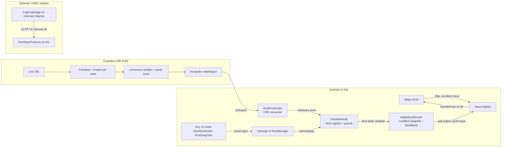

# WalletDesk architecture

Idle wallet inventory stays with the maker. A Uniswap v4 hook fills only the part of a swap the pool is willing to
take. The residual is priced by a custom SwapVM opcode and settled from the best maker desk through the official
Aqua registry, after a price guard against the pool spot and a Chainlink CRE reference. Live addresses and
transactions: `docs/DEPLOYMENTS.md`. Drawing:
`docs/architecture.svg` / `docs/architecture.png`.

## What moves in one swap

1. The router calls `PoolManager.swap` with an exact input above the pool cap. It may settle before or after.
2. `OverflowHook._beforeSwap` checks PoolManager holds the residual, reads the CRE reference (fails closed if a feed
   is set and the reference is missing or stale), and quotes every desk. A desk passes if its quote is within the
   maker's `maxDeviationBps` of both the pool spot and the reference, and the maker wallet and Aqua allowance cover it.
3. The hook `take`s the residual input, calls `WalletDeskRouter.swap` (gas-capped, in try/catch). The unmodified
   SwapVM base calls `Aqua.pull` (maker → hook, output) and `Aqua.push` (hook → maker, input).
4. The hook settles the maker's output into PoolManager and returns `BeforeSwapDelta(+residual, -out)`. The pool
   swaps only the cap. The caller owes the full input and receives pool output plus desk output.
5. If the SwapVM call reverts, the hook returns the residual (`sync` / transfer / `settle`), emits `DeskSkipped` and
   `WouldRoute`, and returns a zero delta: the pool fills everything.

## Off-chain

- `services/cre/desk-guard`: Chainlink CRE workflow that writes the reference (see `docs/CRE.md`). CRE supports
  Unichain Sepolia; the mainnet fork uses a simulator experimental chain.
- `services/keeper`: indexes fills and skips; on a loopback RPC it posts the same median price as a local stand-in
  for CRE and credits fork rebates.

## Rebates (optional)

`FeeShareTreasury` accounts only in the 6-decimal ERC-20 USDC interface; native Arc USDC (18 decimals) is rejected.
`CctpFeeBridge` burns USDC toward Arc domain 26. Iris will not attest an anvil fork, so the local demo credits the
treasury directly and the UI labels it `attestor`. Details: `docs/CCTP.md`.
