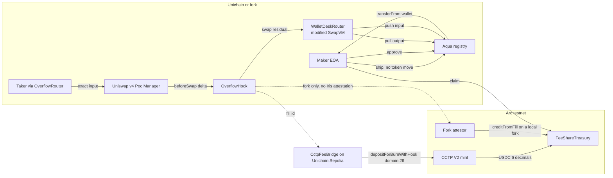

# WalletDesk architecture

Idle wallet inventory stays with the maker. A Uniswap v4 hook fills only the part of a swap the pool is willing to take. The residual is priced by a custom SwapVM opcode and settled from that same wallet through the official Aqua registry. Fees are credited later as USDC on Arc.

Aqua is not deployed on Arc, so the desk and the treasury are different chains.

## What moves in one transaction

1. `OverflowRouter` pulls the taker's input and settles it into the PoolManager.
2. `OverflowHook._beforeSwap` caps the pool leg and takes the residual input back out.
3. `WalletDeskRouter.swap` runs DeskBand, then the unmodified SwapVM base calls `Aqua.pull` and `Aqua.push`.
4. The hook settles the shelf output into the PoolManager and returns a `BeforeSwapDelta` that nets those transfers.
5. The router takes the combined output to the taker.

`WouldRoute` is emitted when the swap is larger than the cap but the caller is not `OverflowRouter`, or no desk is registered after a cap exists. The pool then fills the whole swap and the maker wallet is not touched.

## Arc

`FeeShareTreasury` accounts only in the 6-decimal ERC-20 USDC interface. Native Arc USDC is 18 decimals and is rejected if sent as value.

On Unichain Sepolia, `CctpFeeBridge` burns that USDC through Circle CCTP V2 toward Arc domain 26. Iris will not attest an anvil fork, so the local demo calls `creditFromFill` and the UI labels it `attestor`. Details and the addresses checked on 5 Nov 2026 are in `docs/CCTP.md`.
